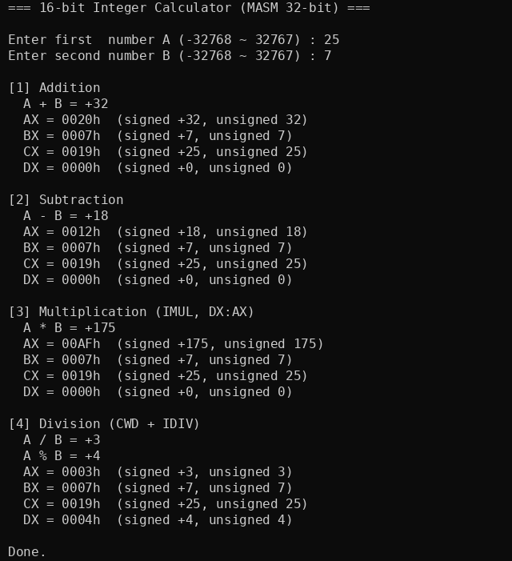

# 16비트 정수 사칙연산 + 레지스터 출력 (32비트 MASM)

두 개의 정수 `A`, `B`를 입력받아 **덧셈 / 뺄셈 / 곱셈 / 나눗셈(몫·나머지)** 을 수행하고,
각 연산 직후 **AX, BX, CX, DX 레지스터의 실제 값**을 16진수·부호 있는 10진수·부호 없는 10진수로 출력합니다.

- 개발 환경: Visual Studio (MASM, x86 / Win32 Console)
- 라이브러리: Irvine32
- 소스 파일: `Calc16.asm`

## 실행 결과




### 예상 출력 (A = 25, B = 7 입력 시)

```text
=== 16-bit Integer Calculator (MASM 32-bit) ===

Enter first  number A (-32768 ~ 32767) : 25
Enter second number B (-32768 ~ 32767) : 7

[1] Addition
  A + B = +32
  AX = 0020h  (signed +32, unsigned 32)
  BX = 0007h  (signed +7, unsigned 7)
  CX = 0019h  (signed +25, unsigned 25)
  DX = 0000h  (signed +0, unsigned 0)

[2] Subtraction
  A - B = +18
  AX = 0012h  (signed +18, unsigned 18)
  BX = 0007h  (signed +7, unsigned 7)
  CX = 0019h  (signed +25, unsigned 25)
  DX = 0000h  (signed +0, unsigned 0)

[3] Multiplication (IMUL, DX:AX)
  A * B = +175
  AX = 00AFh  (signed +175, unsigned 175)
  BX = 0007h  (signed +7, unsigned 7)
  CX = 0019h  (signed +25, unsigned 25)
  DX = 0000h  (signed +0, unsigned 0)

[4] Division (CWD + IDIV)
  A / B = +3
  A % B = +4
  AX = 0003h  (signed +3, unsigned 3)
  BX = 0007h  (signed +7, unsigned 7)
  CX = 0019h  (signed +25, unsigned 25)
  DX = 0004h  (signed +4, unsigned 4)

Done.
```

> 실제 출력은 공백 등 세부 형식이 약간 다를 수 있습니다.

## 레지스터 사용 규칙

| 레지스터 | 의미 |
|:--:|---|
| AX | 연산 결과 (하위 16비트) |
| BX | 피연산자 B |
| CX | 피연산자 A (복사본) |
| DX | 덧셈/뺄셈: 0 · 곱셈: 결과의 상위 16비트 · 나눗셈: 나머지 |

- 입력 범위는 16비트 부호 있는 정수 (`-32768 ~ 32767`)이며, 범위를 벗어나면 다시 입력받습니다.
- 덧셈/뺄셈에서 16비트 오버플로(OF=1)가 발생하면 경고 메시지를 출력합니다.
- 곱셈은 `IMUL BX`로 `DX:AX` 32비트 결과를 출력합니다.
- 나눗셈은 `CWD` + `IDIV BX`를 사용하며, 0으로 나누기와 `-32768 / -1`(#DE 예외)은 미리 검사해서 건너뜁니다.

## Visual Studio 빌드 설정

1. **Irvine32 설치**: `C:\Irvine` 에 Irvine32 라이브러리를 설치합니다. (`Irvine32.inc`, `Irvine32.lib` 등)
2. **프로젝트 생성**: *빈 프로젝트(C++)* 생성 → 플랫폼을 **x86(Win32)** 로 선택
3. **MASM 활성화**: 프로젝트 우클릭 → *빌드 종속성 → 사용자 지정 빌드* → **masm(.targets, .props)** 체크
4. **소스 추가**: `Calc16.asm` 추가 (속성 → 항목 형식: *Microsoft Macro Assembler*)
5. **속성 설정** (구성: 모든 구성 / 플랫폼: Win32)
   - Microsoft Macro Assembler → General → *Include Paths*: `C:\Irvine`
   - Linker → General → *Additional Library Directories*: `C:\Irvine`
   - Linker → Input → *Additional Dependencies*: `Irvine32.lib;kernel32.lib;user32.lib`
   - Linker → System → *SubSystem*: **Console (/SUBSYSTEM:CONSOLE)**
   - Linker → Advanced → *Image Has Safe Exception Handlers*: **No (/SAFESEH:NO)**
6. `Ctrl + F5` 로 실행합니다.

## 참고

- 소스 주석은 인코딩 문제(ML.EXE의 BOM/ANSI 이슈)를 피하기 위해 영문(ASCII)으로 작성했습니다.
- 콘솔에서 한글을 출력하려면 소스 저장 인코딩과 콘솔 코드페이지를 맞춰야 하므로 출력 문자열도 영문으로 두었습니다.

